# RidRim

An AI-first personal finance app built with Flutter — track accounts and transactions, manage budgets and savings goals, monitor bills, debt, and investments, and get answers from an AI assistant that reasons over your own financial data.


---

## Overview

RidRim is a complete, production-quality Flutter finance app scaffold: 30+ screens, a teal-accented Material 3 design system, a clean layered architecture, and an AI assistant surfaced throughout the app (chat, dashboard insights, budget/savings suggestions, forecasting). All data is currently served from a realistic in-memory mock layer, structured so a real backend can be dropped in behind the existing repository interfaces without touching a single screen.

## Key Features

- **AI-first Dashboard** — net-worth summary, a 14-day cash-flow sparkline with a generated insight, spend-by-category donut chart, budget progress, recent transactions, and quick links into every feature.
- **AI Chat Assistant** — ask natural-language questions ("Where did I overspend?", "Show my spending trend") and get answers — including inline bar/line charts — computed from your own mock transactions and budgets.
- **Transactions** — searchable, filterable, date-grouped history; add income/expense entries; per-transaction detail.
- **Accounts** — linked checking, savings, credit, and investment accounts with balances and per-account transaction history.
- **Budgets** — radial progress gauges per category, rollover and AI-optimization preferences.
- **Savings Goals** — goal cards with progress, deadlines, and an "Add funds" flow.
- **Bills & Subscriptions** — overdue/upcoming/paid checklist with reminders.
- **Debt Tracker** — avalanche payoff ordering, a debt-free forecast, and per-debt payoff progress.
- **Investments** — portfolio value, gain/loss, asset allocation donut, and holdings list.
- **Analytics, Forecast & Financial Health** — weekly spend trends, a 6-month balance projection, and a 0–100 financial health score with its contributing factors.
- **Alerts** — a severity-colored notification feed for budgets, bills, and anomalies.
- **Deep Profile & Settings** — a real financial overview, editable financial/risk profile, and one of the most complete AI-settings panels you'll find in a template: 30+ toggles and preferences across Finance, AI, Notifications, Security, Data & Sync, and more.
- **Polished Auth Flow** — gradient-hero, bottom-sheet-card login/register/forgot-password/OTP/reset-password screens.
- **Light & Dark Mode** — a full token-based theme system (colors, spacing, radii, typography) with a single teal accent.

## Screenshots

**Dark theme**

<table>
<tr>
<td align="center">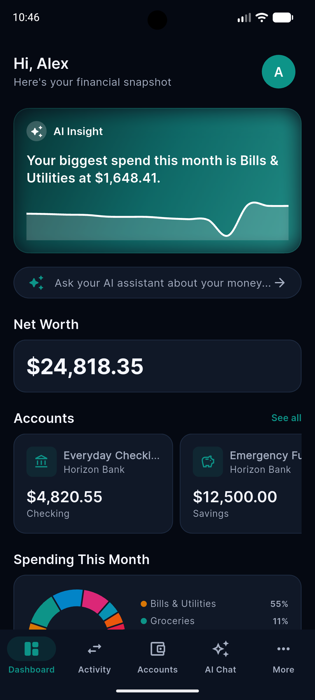<br/><sub>Dashboard</sub></td>
<td align="center">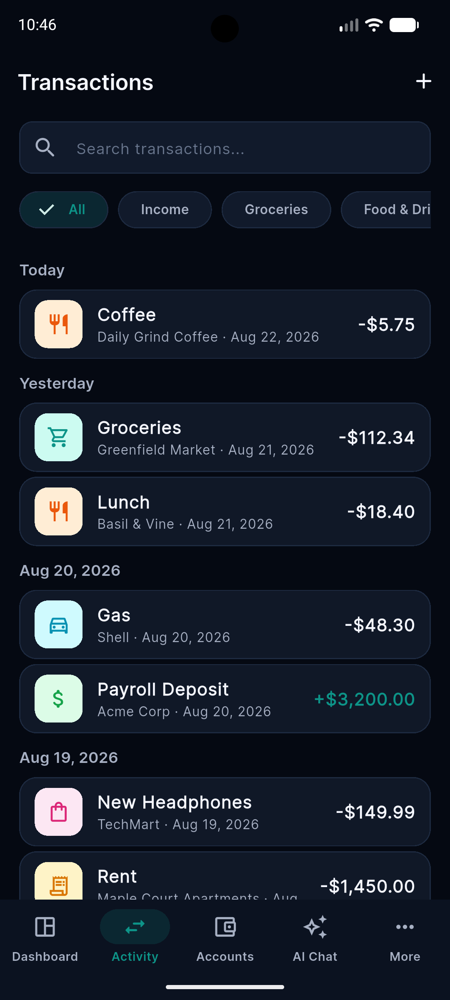<br/><sub>Transactions</sub></td>
<td align="center">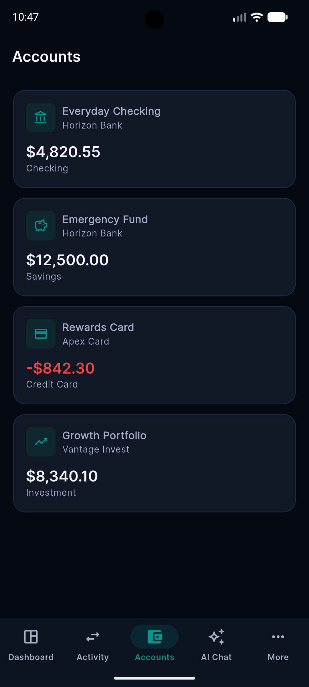<br/><sub>Accounts</sub></td>
<td align="center">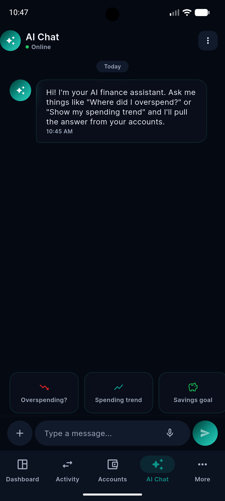<br/><sub>AI Chat</sub></td>
</tr>
<tr>
<td align="center">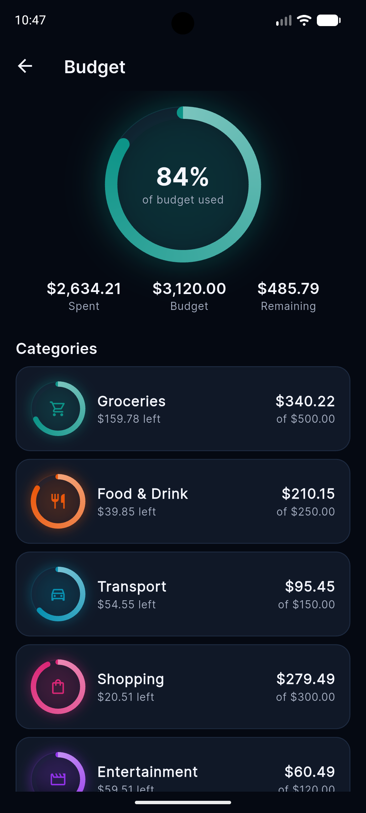<br/><sub>Budget</sub></td>
<td align="center">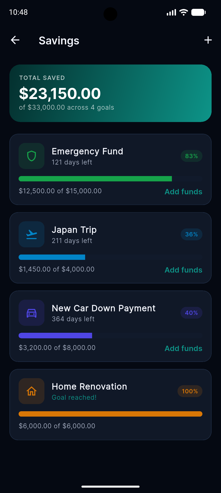<br/><sub>Savings</sub></td>
<td align="center">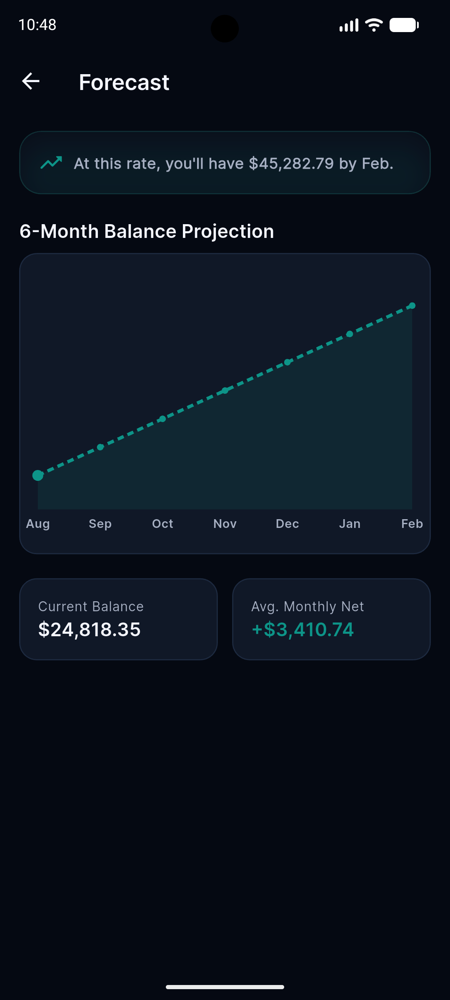<br/><sub>Forecast</sub></td>
<td align="center">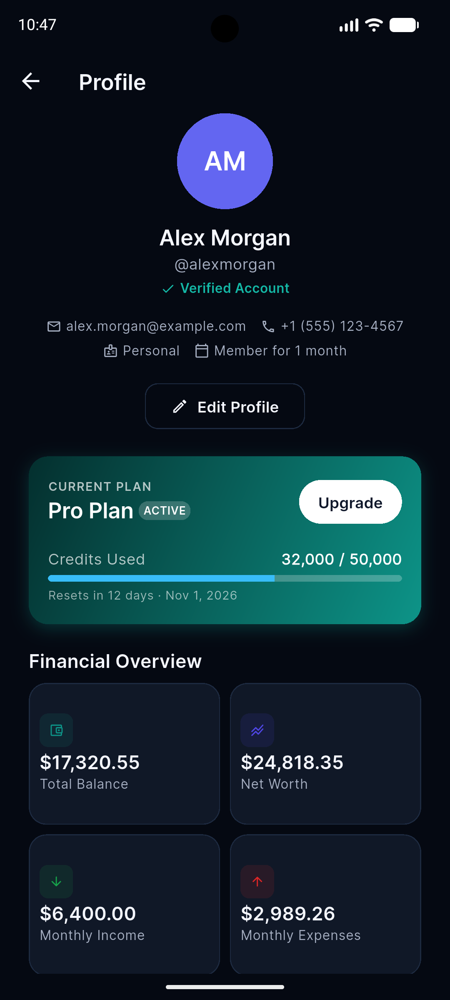<br/><sub>Profile</sub></td>
</tr>
</table>

**Light theme**

<table>
<tr>
<td align="center">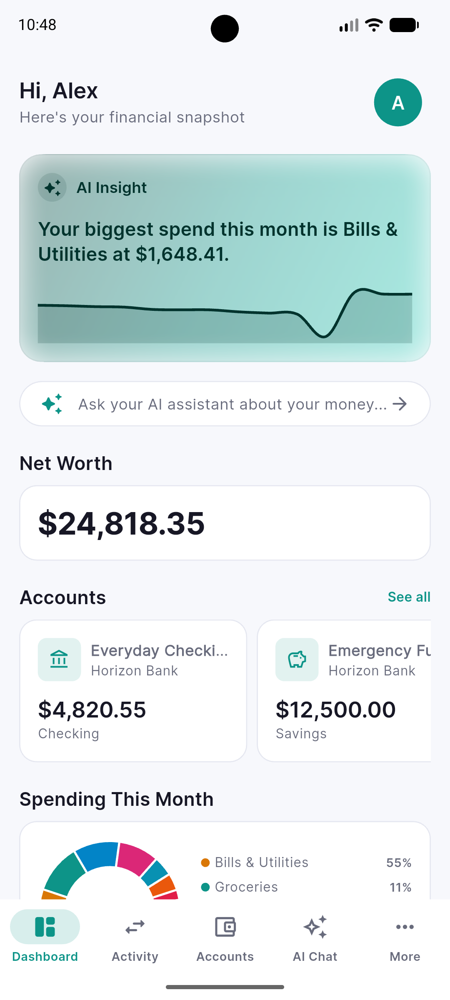<br/><sub>Dashboard</sub></td>
<td align="center">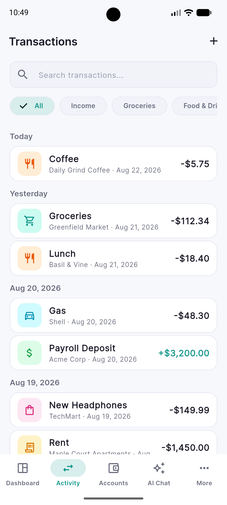<br/><sub>Transactions</sub></td>
<td align="center">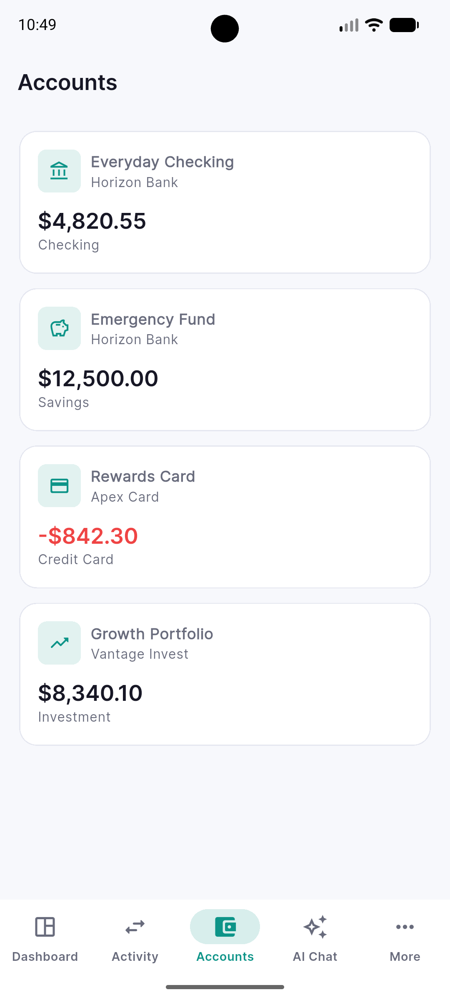<br/><sub>Accounts</sub></td>
<td align="center">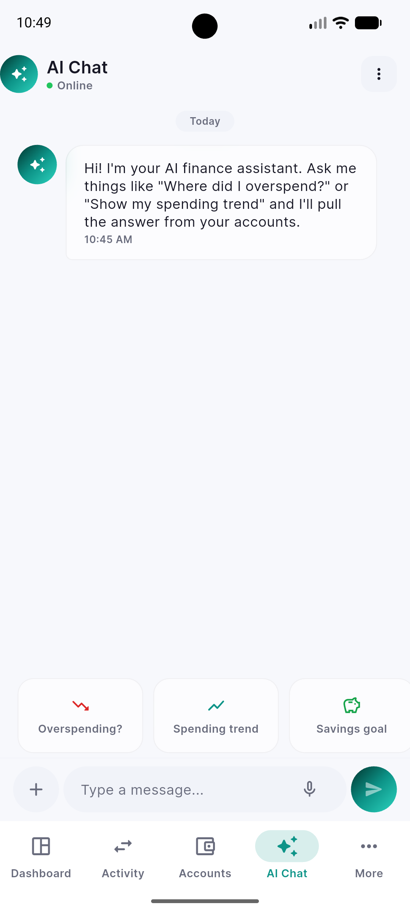<br/><sub>AI Chat</sub></td>
</tr>
<tr>
<td align="center">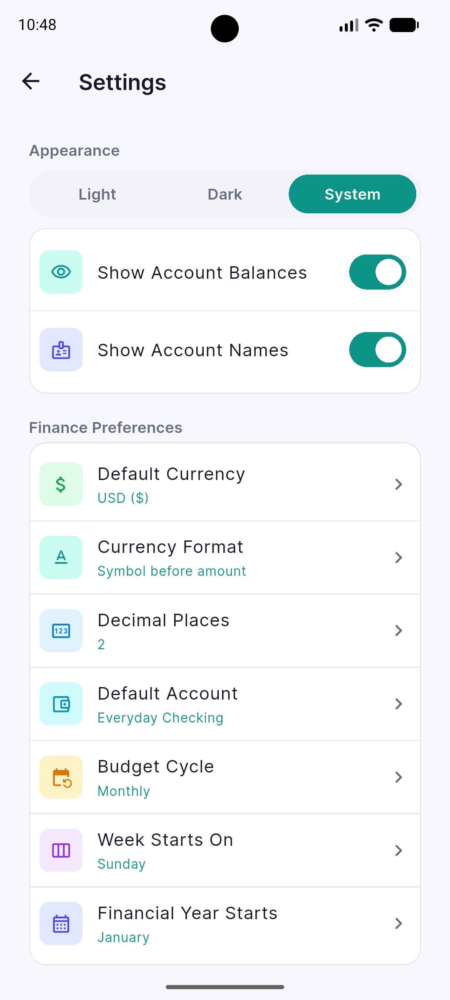<br/><sub>Settings</sub></td>
<td></td>
<td></td>
<td></td>
</tr>
</table>

## Requirements

- Flutter SDK `^3.9.2` (stable channel)
- Dart `^3.9.2`
- Android Studio / Xcode for mobile builds, or Chrome/Edge for web
- A connected device, emulator, or simulator

## Installation

```bash
git clone <repository-url>
cd nexar_finance  # local folder name; the app itself is branded RidRim
flutter pub get
```

## Run Instructions

```bash
# List available devices
flutter devices

# Run in debug mode
flutter run

# Run on a specific device
flutter run -d <device-id>

# Run on web
flutter run -d chrome
```

## Project Structure

```
lib/
├── main.dart                     # App entry point, MaterialApp.router
├── core/                         # Cross-cutting: theme, routing, shared widgets, utils
│   ├── routing/app_router.dart   # GoRouter configuration (all routes)
│   ├── theme/                    # AppColors, AppSpacing, AppRadius, AppTextStyles, AppTheme
│   ├── widgets/                  # AppButton, AppCard, AppTextField, AppGlassCard, ...
│   ├── utils/                    # Extensions, responsive helper, formatters, notifiers
│   └── constants/                # AppStrings, AppAssets, AppConstants
├── domain/                       # Entities, repository interfaces, use cases (pure Dart)
│   ├── entities/
│   ├── repositories/
│   └── usecases/
├── data/                         # Repository implementations + mock data sources
│   ├── models/
│   ├── repositories/
│   └── datasources/mock/
└── features/                     # One folder per feature -- see below
```

## Feature Folder Structure

Every entry under `lib/features/` follows the same shape: a `presentation/`
folder holding `screens/` and `widgets/`, plus a `controller/` (or
`presentation/state`) folder only where a feature needs shared logic beyond
per-screen `setState`. `dashboard/`, fully expanded, is representative:

```
features/dashboard/
├── controller/
│   └── dashboard_controller.dart     # DashboardLogicMixin -- loads accounts,
│                                      #   budgets, transactions for the screen
└── presentation/
    ├── screens/
    │   └── dashboard_screen.dart     # The routed screen (AppRoutes.dashboard)
    └── widgets/
        ├── ai_insight_card.dart      # Hero AI-insight + sparkline card
        ├── budget_progress_list.dart
        ├── quick_link_card.dart
        ├── quick_link_data.dart
        ├── section_header.dart
        └── spend_by_category_chart.dart
```

The full feature list, grouped the way they appear in the app's navigation:

| Group | Feature folders |
|---|---|
| Bottom-nav tabs | `dashboard/`  `transactions/`  `accounts/`  `chat/`  `more/` |
| Finance (pushed from Dashboard/More) | `budget/`  `savings/`  `bills/`  `debt/`  `investments/`  `analytics/`  `forecast/`  `financial_health/`  `alerts/` |
| Account | `profile/`  `settings/`  `subscription/`  `help/` |
| Auth & app shell | `auth/`  `onboarding/`  `splash/`  `home/` (bottom-nav shell) |

A handful of features add one extra folder beyond `presentation/screens` +
`presentation/widgets` because they carry state a single screen can't hold
alone:

- **`controller/`** — `analytics/`, `dashboard/`, `financial_health/`, `profile/`
- **`presentation/controller/`** — `transactions/` (shared add-transaction form state)
- **`presentation/state/`** — `chat/` (message history), `profile/` (edit-form state)
- **`presentation/utils/`** — `profile/` (small formatting helpers local to that feature)

## Architecture Overview

A pragmatic clean/layered architecture, feature-organized:

- **`domain/`** — framework-free entities and repository interfaces + use cases. No Flutter imports.
- **`data/`** — `*Model` classes extend their domain entity (ready for JSON later), `*RepositoryImpl` classes implement the domain interfaces against a `Mock*DataSource`. Swapping mock data for a real API means writing one new data source per feature — no screen changes required.
- **`features/`** — one folder per feature, each with `presentation/screens` and `presentation/widgets` (and `presentation/state` where a feature needs shared logic). Screens wire their own repository/use case instances directly (no DI container) and manage state with plain `StatefulWidget` + `setState`.
- **State management** — intentionally dependency-free: local `setState` per screen, plus a couple of app-wide `ValueNotifier`s (theme mode, font scale, auth state) for the handful of things every screen needs to react to.
- **Navigation** — [go_router](https://pub.dev/packages/go_router), centralized in `core/routing/app_router.dart`. A `StatefulShellRoute` drives the 5-tab bottom navigation; everything else is a normal or nested `GoRoute`. An `isLoggedInNotifier` + `redirect` callback gate every protected route.

## Main Screens / Features

| Area | Routes |
|---|---|
| Onboarding & Auth | `/onboarding`, `/login` (+ register, forgot-password, verify-otp, reset-password) |
| Dashboard | `/dashboard` |
| Transactions | `/transactions`, `/transactions/add`, `/transactions/:id` |
| Accounts | `/accounts`, `/accounts/:id` |
| AI Chat | `/ai-chat` |
| Budget / Savings / Bills | `/budget`, `/savings`, `/bills` |
| Debt / Investments | `/debt`, `/investments` |
| Analytics / Forecast / Financial Health | `/analytics`, `/forecast`, `/financial-health` |
| Alerts | `/alerts` |
| More (menu) | `/more` |
| Profile | `/profile` (+ edit, password-security, payment-methods, billing-history) |
| Settings | `/settings` (+ sessions, about, legal/terms, legal/privacy) |
| Subscription / Help | `/subscription`, `/help` |

See [`DOCUMENTATION.md`](DOCUMENTATION.md) for the full screen-by-screen breakdown.

## Customization

- **Brand color** — change the five `primary*` constants at the top of `lib/core/theme/app_colors.dart`; every gradient, button, chart, and `ColorScheme` derives from them automatically.
- **App name / logo** — `lib/core/constants/app_strings.dart` (`appName`, `appTagline`) and `assets/logo/logo.png` (also used by `flutter_launcher_icons`).
- **Mock data** — every `data/datasources/mock/mock_*_data.dart` file is a self-contained, readable seed list; edit in place.
- **Typography** — `lib/core/theme/app_text_styles.dart` (uses `google_fonts`, currently Inter).

## Theme / Design System

Token-based, not hard-coded: `AppColors`, `AppSpacing`, `AppRadius`, and `AppTextStyles` feed a single `AppTheme.lightTheme` / `AppTheme.darkTheme` pair built on Material 3. Status colors (success/error/warning/info) are exposed via a `ThemeExtension` so widgets read `Theme.of(context).extension<AppStatusColors>()` instead of reaching into `AppColors` directly. No screen defines a color, spacing value, or radius inline.

## Dependencies

| Package | Purpose |
|---|---|
| `go_router` | Declarative navigation, nested & shell routes, auth redirects |
| `fl_chart` | Line, bar, and pie charts across Dashboard, Analytics, Forecast, Chat, Investments |
| `google_fonts` | Inter typeface |
| `flutter_svg` | Social sign-in brand icons |
| `image_picker` / `file_picker` | Chat attachments |
| `speech_to_text` | Voice input in AI Chat |
| `url_launcher` | External links (legal docs, support) |

## Build Instructions

```bash
# Android
flutter build apk --release
flutter build appbundle --release

# iOS
flutter build ios --release

# Web
flutter build web --release
```

## Important Notes

- **No backend is wired up.** Every list, balance, and chart is powered by an in-memory mock data source under `lib/data/datasources/mock/`. Authentication is simulated (any valid-format email/password succeeds); nothing is persisted between app restarts.
- **Package name is `ridrim`.** The Flutter package/import prefix (`package:ridrim/...`) matches the app's branding; the app is titled and branded as RidRim everywhere a user sees it, and the Android `applicationId`/iOS `PRODUCT_BUNDLE_IDENTIFIER` are `com.ridrim.finance` (change this before your own store listing if you want a different identifier).
- A handful of screens (Investments, Debt, some AI-settings toggles) are intentionally demo/preview quality — realistic UI over mock data — pending a real brokerage/banking data integration.

## License

Proprietary. All rights reserved unless a license file is added to this repository.

## Support

For questions about this codebase, see [`DOCUMENTATION.md`](DOCUMENTATION.md) first — it covers architecture, customization, and troubleshooting in depth.
